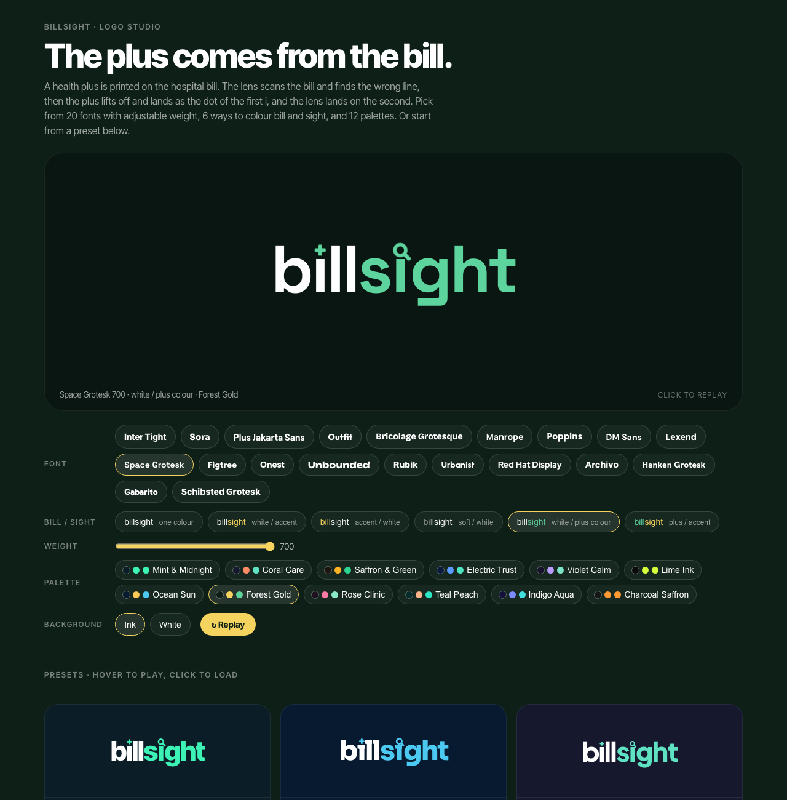
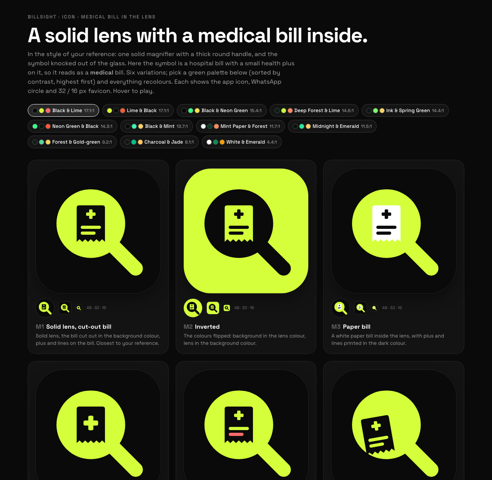
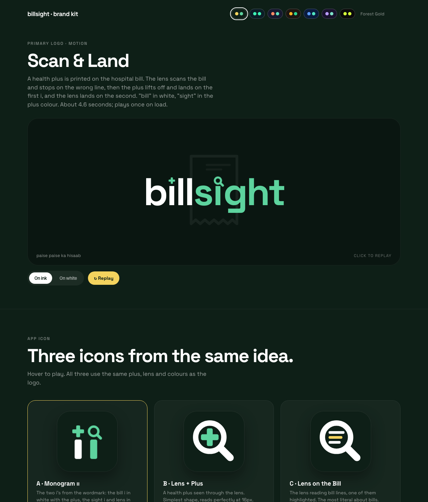

<h1 align="center">Brand Studio</h1>

<p align="center"><em>A brand identity studio for AI coding agents. Logos that move, icons that read at 16 px, and a brand kit you can click through. Every page is screenshot-checked before you see it.</em></p>

<p align="center">
  
  
  
</p>

<p align="center"></p>

---

## What it does

You describe a product. Your agent builds its identity step by step, as interactive HTML pages you open in a browser:

| Step | You get |
|---|---|
| **Name** | Name ideas that suit the logo concept, live domain checks (RDAP), trademark-risk flags |
| **Direction** | 3 to 4 visual directions, then a landing page in the chosen one |
| **Logo lab** | A grid of animated logo options and a big stage. Hover to play, click to load, switch background and accent, "Use on page" |
| **Story logo** | A logo animation that means something: an object appears, a tool examines it, the key moment lights up, parts fly into letter slots |
| **Logo studio** | 20 variable fonts with a weight slider, two-colour wordmark splits, 12+ palettes, presets |
| **Identifier** | Symbols, monograms, container icons and lockups, each previewed at app-icon, 48, 32 and 16 px |
| **Icon motion** | The icon opens into the full scene, the tool works, and it folds back |
| **Brand kit** | Logo motion, app icons, phone / chat / browser-tab previews, loader, colour and motion spec, exports |

<p align="center">
  
  
</p>

## Why it's different

- **It checks its own work.** Headless-Chrome screenshots, zoomed crops of every mark, and frozen mid-animation frames, so overlaps and misplaced dots are caught before you see them.
- **Marks are placed from real glyphs.** Letter dots, counters and stems are measured from the actual font on a canvas, so a symbol on an "i" stays right when you switch fonts.
- **It takes feedback the way designers do.** Favourites become mixes; "I don't like the colours" becomes a live palette row ranked by contrast; a pasted reference image is copied construction-first.
- **No build step.** Every deliverable is one HTML file you can open, share or host.

## Install

**Claude Code**

```
/plugin marketplace add YOUR_GITHUB_USER/brand-studio
```
```
/plugin install brand-studio@brand-studio
```

Then ask for a logo, a brand kit or an app icon, or run `/brand-studio <your product idea>`. Other agents: see [INSTALL.md](INSTALL.md).

**Needs:** Google Chrome (for screenshots and icon exports), Python 3, and macOS `sips` for crops and resizes (Linux: swap in ImageMagick).

## Commands

| Command | What it does |
|---|---|
| `/brand-studio [idea or step]` | Start or continue a brand |
| `/brand-verify <page.html>` | Screenshot-check a page, zoom into details, check animation frames, fix issues |

## What's inside

```
.claude-plugin/          plugin + marketplace manifests
commands/                /brand-studio, /brand-verify
skills/brand-studio/
  SKILL.md               workflow, feedback handling, rules, checklist
  references/
    design-patterns.md   letter-slot marks, story choreography, icon families, palettes, fonts
    lessons.md           the SVG / animation / font / screenshot bugs that cost the most time
  scripts/
    shot.sh              headless screenshot (--static for final states)
    crop.sh              zoom into a detail
    freeze-frame.py      capture a mid-animation frame (Web Animations API)
    export-icons.sh      1024 / 512 / 192 PNGs, favicons, apple-touch
    check-domains.sh     domain lookup via RDAP
  templates/             worked examples from a real project: logo lab, logo studio,
                         brand kit, symbol grid, wordmark lockups, icon + palette + motion
AGENTS.md                the same instructions for agents without plugin support
```

The templates are a real case study, so they carry that project's name and colours. The skill tells the agent to reuse their mechanics and replace the content.

## License

MIT
